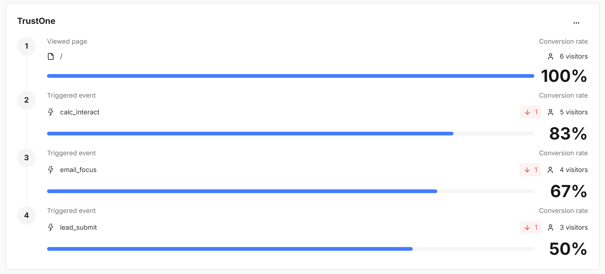

# TrustOne – konverzní landing page se srovnáním ETF

Lead magnet pro českého drobného investora, který přichází z reklamy na Meta (mobil) a stránce věnuje pár sekund. Stránka okamžitě ukáže modelový rozdíl v nákladech mezi bankovním akciovým fondem a ETF, srovná 5 ETF z newyorské burzy s jejich evropskými (UCITS) verzemi a výměnou za e-mail nabídne **osobní přehled** (na stránce, v PDF a e-mailem).

- **Repozitář:** https://github.com/osho4753/etf-landing-page
- **Web:** https://etf-landing-page-three.vercel.app (varianta B: `?utm_content=b_compare`)
- **Reklamy:** [ads/README.md](ads/README.md) (obrázky 1080 × 1350 + texty pro Meta)
- **Zadání a plán s ověřenými fakty:** [docs/00-zadani.md](docs/00-zadani.md), [docs/01-plan.md](docs/01-plan.md)
- **Export konverzace s Claude Code:** [ai-log/](ai-log/) (`/export` a úplný export, viz [ai-log/README.md](ai-log/README.md))
- **Kontrola proti zadání:** [kapitola 14](#14-kontrola-proti-zadání)

TrustOne je fiktivní značka. Nevydává se za banku ani brokera a na stránce, v PDF i v reklamách je uvedeno, že nejde o investiční doporučení.

---

## 1. Cílová skupina

Čech 25–45 let, peníze má na spořicím účtu, ve stavebním spoření nebo v podílovém fondu od banky. Slyšel o ETF a S&P 500 (YouTube, kolegové, Reddit), zná tickery jako VOO nebo SPY, ale neví, který fond vybrat a jak ho z Česka koupit. Bojí se poplatků a „udělat chybu“. Přichází z Instagramu/Facebooku na mobilu a během 3–8 sekund se rozhoduje, jestli zůstane.

Z toho plyne: číslo, které odpovídá na otázku z reklamy, musí být vidět bez scrollování; formulář až ve chvíli, kdy má návštěvník svoje číslo; žádné registrace, telefony ani dotazníky.

## 2. Co návštěvník dostane a kdy žádáme o kontakt

**Zdarma a bez formuláře:** modelový výpočet v hero, kalkulačka s vlastními čísly a grafem, srovnání 5 ETF s evropskými verzemi (tickery, ISIN, TER, odkaz na justETF), vysvětlení, proč americká ETF z Česka většinou nekoupí.

**Za e-mail – „Osobní přehled“** (modelový výpočet a přehled možností, žádné „kupte X“):
1. jeho čísla, graf a rozdíl v nákladech,
2. vybrané NYSE ETF a jeho evropská verze (ISIN, TER, akumulace, odkaz na justETF),
3. obecný postup prvního nákupu v 6 krocích,
4. daně v ČR (časový test 3 roky, limit 100 000 Kč) se zdrojem,
5. zdroje a disclaimer.

**Kdy žádáme:** formulář je přímo pod výsledkem kalkulačky (moment nejvyšší motivace – „tohle je moje číslo“), u každé karty srovnání tlačítko „Přehled pro VOO → VUAA“, které předvybere ETF a skočí na formulář, a samostatná sekce „Co dostanete za e-mail“. Na mobilu se po odscrollování objeví spodní lišta „Osobní přehled zdarma“.

**Po odeslání:** přehled se **okamžitě** zobrazí na stránce (garantované doručení hodnoty), tlačítko stáhne PDF (generuje se v prohlížeči, font s českou diakritikou je vložený) a Brevo pošle e-mail s odkazem na přehled. Když e-mail selže, uživatel to nepozná – hodnotu už má.

**Formulář:** jedno pole (e-mail), jedno povinné potvrzení „Beru na vědomí zpracování e-mailu pro zaslání přehledu“ s odkazem na [/ochrana-udaju](src/app/ochrana-udaju/page.tsx) a samostatné **nepovinné, ve výchozím stavu nezaškrtnuté** políčko pro marketing (atribut `MARKETING`). Validace na klientu i serveru, stavy odesílám / hotovo / chyba, honeypot proti botům. Funguje i bez JavaScriptu (klasický POST → přesměrování na `/prehled`).

## 3. Pořadí sekcí a proč

Dvě varianty podle reklamy (message match). Přepíná je `src/proxy.ts` podle `utm_content` (`b…` → statická stránka `/b`, jinak `/`), obě jsou předgenerované, takže bez probliknutí a bez JS.

| # | Varianta A – „poplatky“ | Varianta B – „srovnání“ | Proč tady |
|---|---|---|---|
| 1 | **Hero:** „Kolik vám za 20 let sní poplatky fondu?“ + „přes 400 000 Kč“ jako v reklamě A (modelově 489 000 Kč, globální ETF VWCE vs. fond na akcie USA a Evropy), pruhy, CTA | **Hero:** „VOO, SPY, nebo VT? Tohle z Česka opravdu koupíte.“ + 3 dvojice tickerů s TER, CTA | Navazuje doslova na slib reklamy; odpověď je nad ohybem, hodnota je zřejmá před formulářem. |
| 2 | **Kalkulačka** + formulář pod výsledkem | **Proč VOO z Česka nekoupíte** (KID/PRIIPs ve 3 krocích) | A: návštěvník chce „svoje číslo“. B: překvapivá informace z reklamy potřebuje vysvětlení, jinak nevěří. |
| 3 | **Proč VOO z Česka nekoupíte** | **Srovnání 5 ETF ↔ UCITS** s CTA na každé kartě | A: druhá vrstva hodnoty pro ty, které čísla nezaujala. B: jádro slibu reklamy. |
| 4 | **Srovnání 5 ETF ↔ UCITS** | **Kalkulačka** + formulář | A: vstup ke kontaktu přes konkrétní fond. B: po výběru ETF si spočítá, kolik ušetří. |
| 5 | **Co dostanete za e-mail** + formulář | totéž | Pro váhající: konkrétně ukázat obsah přehledu a odstranit nejistotu („žádný poradce, který by volal“). |
| 6 | **FAQ** (kdo jsme, není to doporučení, proč 6 %, daně, spam) + CTA | totéž | Námitky řešené těsně před posledním CTA. |
| 7 | **Zdroje dat** + patička s právními texty | totéž | Důvěra a právní minimum; každé číslo má zdroj a datum. |

Po odeslání se mezi sekce 4 a 5 vloží **osobní přehled** a stránka na něj odroluje.

## 4. Data a zdroje

Všechna čísla načítá skript `npm run data` (`scripts/fetch-data.mjs`) ze **surových dat emitentů** (HTML, JSON API, PDF factsheety a KID) – ne ze sumarizací. Důvod: v kroku ověřování automatický sumarizátor posunul sloupce výkonnosti u SPY; chyba se odhalila porovnáním s VOO (stejný index). Výstup:

- `data/etf.json` – 5 ETF z NYSE Arca (SPY, IVV, VOO, VT, VWO): burza (adresář Nasdaq Trader), TER, aktiva, výkonnost NAV k 30. 9. 2026, UCITS ekvivalent (SPYL, CSPX, VUAA, VWCE, VFEA) s TER, ISIN a odkazem na justETF. Každá hodnota má URL zdroje, datum a poznámku.
- `data/fees.json` – bankovní fond z KID (náklady, cíl fondu, referenční hodnota, zajištění měny), předpoklady výpočtu, výchozí ETF (VT).
- `data/raw/evidence.json` – důkazní výňatky ze zdrojů (37 položek).

Testy (`npm test`) hlídají výpočet i to, že čísla v reklamách odpovídají datům.

## 5. Rozhodnutí

| Rozhodnutí | Důvod |
|---|---|
| **Konkrétní brokery neuvádíme.** Text „u brokerů, kteří nabízejí UCITS ETF“ + u každého UCITS ETF odkaz na justETF. | Dostupnost konkrétních fondů u konkrétních brokerů se nepodařilo ověřit z primárních zdrojů. |
| **Srovnávací bankovní fond: ČSOB Akciový zodpovědný** (KID ze dne 1. 6. 2026; vstup max. 3 % dle KID, průběžné náklady 2,65 % ročně). Výchozí ETF pro srovnání je **VT → VWCE** (FTSE All-World). | Preferovaný Top Stocks (Erste/ČS) nemá veřejně dohledatelný KID z roku 2026 (nalezený dokument z 2026 je factsheet, KID je z 22. 5. 2023). Transakční náklady (0,42 %) nezapočítáváme – konzervativně. Podle KID fond investuje „na světových trzích, a to zejména na trzích USA a Evropy“, referenční hodnota je 65 % MSCI USA + 35 % MSCI Europe. Nejbližší z našich ETF je proto globální VWCE, ne S&P 500. VWCE je ale širší (i Japonsko, další Asie, rozvíjející se trhy) a fond měnové riziko většinou zajišťuje, ETF ne, takže srovnání ukazuje vliv nákladů, ne stejné portfolio. Říká to i poznámka pod kalkulačkou. |
| **Modelový výnos 6 % p. a.** pro obě varianty, náklady brokera 0,5 % z vkladu (předpoklad). | Rozdíl tak ukazuje jen vliv nákladů; předpoklady jsou pod grafem, v hero, v PDF i v reklamě. |
| **Lead magnet jako „Osobní přehled“** – modelový výpočet a přehled možností. | Konkrétní doporučení nákupu by se blížilo investičnímu poradenství, na které TrustOne nemá oprávnění. |
| **Next.js se statickými stránkami + jedna serverová funkce `/api/lead`.** | API klíč k Brevo nesmí být v prohlížeči; čistý statický export by serverovou funkci neuměl. |
| **Umami (cookieless)** místo PostHogu. | Bez cookies → bez cookie lišty; skript má jednotky kB; funnel a UTM v bezplatném plánu. |
| **Lead se ukládá do Brevo** (seznam „TrustOne leads“) s atributy `VARIANTA, ETF, VKLAD_START, VKLAD_MESIC, HORIZONT, ROZDIL, ZDROJ_FORM, LEAD_CAS, MARKETING`. Když uložení selže, data se zapíšou do logu Vercelu (`lead_backup`). | Žádná vlastní databáze; uživatel hodnotu dostane vždy. |
| **Graf jako vlastní SVG**, PDF přes `pdf-lib` načtené až po kliknutí. | Nula kB JavaScriptu navíc při načtení stránky. |

## 6. Měření

Umami Cloud, bez cookies. Všechny události nesou `variant` (a/b), `page` a UTM parametry z URL; `landing` navíc referrer.

| Událost | Kdy vzniká |
|---|---|
| `landing` | načtení stránky (+ `utm_source/medium/campaign/content`) |
| `scroll_25` / `scroll_50` / `scroll_75` | dosažení hloubky stránky |
| `cta_click` | klik na CTA (`location`: hero / compare / faq / sticky) |
| `calc_interact` | **první vlastní změna** jezdce kalkulačky |
| `calc_result_view` | výsledek kalkulačky ve viewportu ≥ 1 s **až po** `calc_interact` (modelový příklad v hero ani pasivní scroll ji nevyvolají – ověřeno e2e testem) |
| `compare_interact` | výběr ETF ve srovnání nebo v kalkulačce, klik na justETF (`ticker`, `action`) |
| `email_focus` | první focus do pole e-mail (`location`) |
| `form_error` | chyba validace / sítě / PDF (`type`) |
| `lead_submit` | úspěšné uložení kontaktu, jednou na odeslání (`location`, `etf`, `flow`). `flow: inline` – formulář s JS, přehled se ukáže na stejné stránce. `flow: redirect` – formulář odeslaný bez JS nebo před hydratací; server přesměruje na `/prehled?…&odeslano=1` s variantou a UTM z refereru, událost odejde až tam a parametr `odeslano` se z URL odstraní, aby ji reload nezopakoval. |
| `pdf_download` | stažení PDF |

**Definice funnelu (Umami → Reports → Funnel, okno 60 minut).** Krok v Umami je URL nebo událost a nepodporuje „nebo“, proto dvě cesty a jedna souhrnná. Prvním krokem je **návštěva stránky `/`** (pageview, který Umami zaznamená automaticky). Pokrývá obě varianty: variantu B obsluhuje `src/proxy.ts` přepsáním (rewrite), takže v prohlížeči i v Umami zůstává adresa `/`. Událost `landing` slouží k rozpadu podle UTM a refereru, ne jako krok funnelu.

1. **Kalkulačka:** návštěva `/` → `calc_interact` → `email_focus` → `lead_submit`
2. **Srovnání:** návštěva `/` → `compare_interact` → `email_focus` → `lead_submit`
3. **Souhrn:** návštěva `/` → `email_focus` → `lead_submit` → `pdf_download`

**Poslední krok funnelu je `lead_submit`, ne zobrazení `/prehled`.** Při běžném odeslání s JS se na `/prehled` vůbec nepřechází (přehled se zobrazí na landing page), takže pageview `/prehled` by zachytil jen menšinovou cestu bez JS a navíc i otevření odkazu z e-mailu. `lead_submit` vzniká v obou cestách právě jednou a až po úspěšné odpovědi `/api/lead`; ověřuje `npm run e2e:lead` (Playwright zachytí požadavky na Umami `/api/send`).

Konverze = `lead_submit` / návštěvy `/`. Varianty reklamy se porovnávají filtrem `variant` / `utm_content`. Do funnelu záměrně nebereme `calc_result_view`, protože interakci neprokazuje tak jednoznačně jako `calc_interact`.

**Funnel v Umami na produkci (kalkulačková cesta):**



> **Pozor: nejde o reálný provoz.** Screenshot zachycuje jen mé vlastní testovací průchody (6 návštěv), žádné návštěvníky z reklamy. Čísla v něm (např. 50 % na `lead_submit`) proto o konverzi nic neříkají. Screenshot dokládá jen to, že měření funguje od příchodu na stránku až po odeslání formuláře. Očekávaná konverze je odhad v [kapitole 7](#7-očekávaná-konverze).

## 7. Očekávaná konverze

Kotva: Unbounce Conversion Benchmark Report (finance, aktualizace 25. 2. 2026) – medián finančních služeb 8,3 %, podkategorie investic 3,9 %, placené sociální sítě ve financích 9,3 %; ve financích konvertuje mobil lépe než desktop. Naše výhody: jedno pole, hodnota před formulářem, message match. Nevýhody: studený provoz, neznámá značka.

| Krok | z předchozího | ze 100 návštěv |
|---|---|---|
| Příchod (návštěva `/`) | – | 100 |
| Zůstane / scroll 25 % | 60 % | 60 |
| Vlastní výpočet nebo interakce se srovnáním | 70 % | 42 |
| Focus do e-mailu | 30 % | 12,6 |
| Odeslání | 45 % | **≈ 5,7 %** |

**Očekávaná konverze návštěva → lead: 5–6 %** (pesimisticky 3,5 % ≈ medián investic, optimisticky 9 % ≈ medián paid social ve financích). Mezikroky jsou odhad; ověří se po prvních ~1 000 návštěvách.

## 8. Tři hypotézy na A/B test (podle očekávaného dopadu)

1. **E-mail přímo v hero pod modelovým číslem** vs. formulář až pod kalkulačkou. Většina mobilních návštěvníků ze sociálních sítí nescrolluje; formulář v prvním viewportu zvětší krok „focus“. Očekávaný dopad nejvyšší.
2. **Personalizovaný slib s ukázkou** („Váš ETF: VOO → VUAA, 0,07 %. Celý přehled vám pošleme.“) vs. obecné „Osobní přehled zdarma“. Konkrétní, viditelně „můj“ obsah zvyšuje vnímanou hodnotu výměny.
3. **Hero B (zvědavost „VOO z Česka nekoupíte“) i pro provoz z reklamy A** vs. hero A (strach z poplatků). Nejnejistější dopad, protože mění message match – proto poslední.

## 9. Kvalita

- **Lighthouse – produkce po optimalizaci LCP (12. 10. 2026).** Měřeno Lighthouse 12 se simulovaným škrcením, stejně jako PageSpeed Insights. Mobil odpovídá Moto G Power na pomalém 4G, desktop presetu Lighthouse. Umami bylo při měření blokované, aby test neznečistil data. PageSpeed Insights se v den měření použít nedalo: API vracelo „Quota exceeded“ a web „Unable to resolve“.

  | Produkce (Vercel) | Výkon | Přístupnost | Best practices | SEO | FCP | LCP | TBT | CLS | Běhy (výkon) |
  |---|---|---|---|---|---|---|---|---|---|
  | **Mobil A** – medián z 5 | 93 | 100 | 100 | 100 | 1,7 s | 2,8 s | 70 ms | 0 | 92–94 |
  | **Mobil B** – medián z 5 | 93 | 100 | 100 | 100 | 1,7 s | 2,8 s | 100 ms | 0 | 93 |
  | **Desktop A** – medián ze 3 | 100 | 100 | 100 | 100 | 0,5 s | 0,6 s | 0 ms | 0 | 100 |
  | **Desktop B** – medián ze 3 | 100 | 100 | 100 | 100 | 0,5 s | 0,6 s | 0 ms | 0 | 100 |
  | *Mobil A / B před optimalizací* | *92 / 90* | *100* | *100* | *100* | *1,7 s* | *3,1 s* | *120 ms* | *0* | *90–92* |
  | Lokálně (`next start`), mobil A / B – medián z 5 | 96 / 96 | 100 | 100 | 100 | 1,5 s | 2,6 s | 100–120 ms | 0 | 92–97 |

  **LCP.** LCP prvkem je text v hero (nadpis, u A někdy odstavec pod ním).
  - Co blokovalo první vykreslení:
    - pět souborů fontů z Google Fonts (110 kB), z toho tři se prohlížeč dozvěděl až po stažení CSS (nadpisový font a symboly Onest kvůli znaku „→“),
    - blokující CSS soubor.
  - Opravy:
    - vlastní podmnožiny fontů s češtinou a použitými symboly: Onest 27 kB a Bricolage 800 22 kB, oba přednačtené,
    - CSS vložené přímo do HTML (`experimental.inlineCss`).
  - Výsledek: LCP na produkci klesl z 3,1 s na 2,8 s.
  - **Cíl pod 2,5 s splněný není.** Zbytek tvoří vyhodnocení JavaScriptu Reactu a Next.js (~160 kB), které Lighthouse započítá, když proběhne před prvním vykreslením.
  - V produkčních trasách z mého prohlížeče se navíc první snímek ukazuje až kolem 2,2 s, přestože je stránka zpracovaná za 0,13 s a hlavní vlákno mezitím nic nedělá. Lokálně se to stalo jen ve 2 z 10 běhů. Je potřeba to ověřit v PageSpeed Insights.
  - Vyzkoušel jsem a nepoužil:
    - přednačtení nadpisového fontu z Google (LCP se zhoršil),
    - `content-visibility` pro sekce pod ohybem (snížila přístupnost na 96, axe u přeskočených sekcí špatně určí pozadí).

  Screenshoty: [mobil A](docs/lighthouse/screenshot-mobil-a.png), [mobil B](docs/lighthouse/screenshot-mobil-b.png), [desktop A](docs/lighthouse/screenshot-desktop-a.png), [desktop B](docs/lighthouse/screenshot-desktop-b.png). Reporty: [produkce mobil](docs/lighthouse/produkce/), [produkce desktop](docs/lighthouse/produkce-desktop/), [lokálně](docs/lighthouse/lokalne/). Spuštění: `npm run lighthouse` (`BASE_URL=… OUT_DIR=… FORM_FACTOR=desktop`).
- **Animace.** Sekce a karty se při scrollu jemně odkryjí (prolnutí a posun o 16 px, 450 ms, karty po 80 ms), postará se o to `src/components/Reveal.tsx` a CSS v `globals.css`.
  - Nic v prvním viewportu se neanimuje a každý prvek se animuje jen jednou.
  - Bez JS i při `prefers-reduced-motion: reduce` je vše hned viditelné. Skrytí platí jen s třídou `reveal` na `<html>`, kterou přidává JS.
  - Výkon ani přístupnost se tím nezměnily (ověřeno: lokálně 96 / 100 s animací i bez ní).
- **Fonty** jsou podmnožiny Onest a Bricolage Grotesque (SIL Open Font License 1.1), zdroj a licence: [src/app/fonts/LICENSE.md](src/app/fonts/LICENSE.md).
- **E2E** `npm run e2e` (Playwright, 390 px): průchod hero → kalkulačka → srovnání → chybový stav formuláře → odeslání → přehled → PDF; kontrola, že pasivní scroll nevyvolá události kalkulačky. Umami je blokované a `/api/lead` mockované. Screenshoty: [docs/screenshots/](docs/screenshots/).
- **Bez JS:** hlavní texty, modelové číslo, srovnání i disclaimery jsou ve statickém HTML; formulář funguje klasickým POSTem.
- **Bez cookies:** Umami ani stránka cookies nepoužívají, proto bez cookie lišty.

## 10. Spuštění

```bash
npm install
cp .env.example .env.local   # BREVO_API_KEY, BREVO_SENDER_EMAIL, BREVO_LIST_ID, NEXT_PUBLIC_UMAMI_WEBSITE_ID
npm run dev                  # vývoj
npm test                     # výpočet + čísla v reklamách
npm run build && npx next start -p 3100
npm run e2e                  # vyžaduje běžící server na :3100
npm run lighthouse           # vyžaduje běžící server na :3100 (nebo BASE_URL) a Chrome
npm run data                 # znovu stáhne data emitentů (vyžaduje pdftotext)
npm run ads                  # vyrenderuje reklamy do PNG
```

V Brevo je potřeba vytvořit seznam a atributy kontaktu uvedené v kapitole 5 a ověřit odesílací adresu. Bez proměnných prostředí stránka funguje, lead se jen zapíše do logu.

## 11. Právní minimum

„Nejde o investiční doporučení“ v hero, pod kalkulačkou, v přehledu, PDF, reklamách i patičce; upozornění, že minulá ani modelová výkonnost nezaručuje budoucí výnosy; stránka [Ochrana osobních údajů](src/app/ochrana-udaju/page.tsx); zdroje dat s datem u tabulky, grafu i v samostatné sekci. Právní posouzení skutečným právníkem je mimo rozsah tohoto testu.

## 12. Chyby a zjištění při testování

| Zjištění | Jak se přišlo | Oprava |
|---|---|---|
| **Ztráta `lead_submit` a UTM při odeslání bez JS.** Na pomalém mobilu může návštěvník odeslat formulář dřív, než se načte JavaScript (před hydratací). Formulář pak odejde klasickým POSTem a server přesměruje na `/prehled`. Tam se `lead_submit` vůbec neodeslal, UTM parametry se ztratily a stránka měla natvrdo variantu `a`. Takový lead ve funnelu chyběl a nešel přiřadit k reklamě. | Revize měření pro cestu odeslání bez JS. | Server při přesměrování přidá do URL `odeslano=1`, variantu, místo formuláře a UTM převzaté z refereru (`submittedPath` v `src/lib/lead.ts`). `/prehled` pak odešle `lead_submit` s `flow: redirect` a správnou variantou. Parametr `odeslano` se z URL hned odstraní, aby reload událost nezopakoval. Cesta s JS posílá `flow: inline`. Ověřují unit testy (`src/lib/lead.test.ts`) a `npm run e2e:lead` (zachycené požadavky na Umami). |
| `calc_result_view` vznikala bez interakce: modelový výsledek je vidět už při načtení. | Seznam událostí z e2e průchodu. | Událost vzniká až po `calc_interact`. Funnel stojí na `calc_interact`. E2e kontroluje, že pasivní scroll nic nevyvolá. |
| Posunuté sloupce výkonnosti u SPY. | Porovnání s VOO (stejný index) při ověřování dat. | Data se berou jen ze surových zdrojů emitentů (`npm run data`), ne ze sumarizací. |
| Číslo v reklamě nesedělo s výpočtem (poměr 69,5 % místo 69,6 %). | Test `src/lib/ads.test.ts`. | Opravena reklama i test. Test teď hlídá čísla v reklamách proti datům. |
| PDF zalamovalo „3 %“ přes řádek. | Kontrola vyrenderované strany PDF (screenshot [08-pdf-strana1.png](docs/screenshots/08-pdf-strana1.png)). | Nezlomitelná mezera před „%“. Font Onest s českou diakritikou je v PDF vložený. |
| Lighthouse zpočátku: výkon A 70 / B 87, přístupnost 93, SEO u B 63. | `npm run lighthouse`. | Kontrast barvy (token `mint-ink`), `inert` místo `aria-hidden` u spodní lišty, favicon, canonical místo `noindex` u `/b`, menší načítání nadpisového fontu. Výsledek je v kapitole 9. |
| E2e běh proti lokálnímu serveru s reálnými klíči poslal testovací kontakt do Brevo a události do Umami. | Kontrola dat po testu. | E2e testy blokují Umami a `/api/lead` mockují. Test `e2e:lead` zachytává požadavky na Umami a nepouští je ven. |
| Produkce na Vercelu vracela 404. Canonical by ukazoval na `localhost`. | Ověření po prvním nasazení. | `vercel.json` s `framework: nextjs`. Canonical se bere z produkční domény Vercelu. |

## 13. Práce s AI

Celá stránka vznikla v Claude Code. Exporty konverzace jsou v [ai-log/](ai-log/), popis obou souborů je v [ai-log/README.md](ai-log/README.md).

**Pokyny**
- Zadání je uložené beze změny ([docs/00-zadani.md](docs/00-zadani.md)).
- Prvním krokem byl jen plán s ověřením faktů ([docs/01-plan.md](docs/01-plan.md)). Fakta jsou v plánu označená jako OVĚŘENO / ČÁSTEČNĚ / PŘEDPOKLAD / OTÁZKA. Bez schválení plánu agent nic neinstaloval a nepsal kód.
- Po schválení dostal agent 8 rozhodnutí:
  - stack,
  - lead magnet jako „Osobní přehled“ (žádné „kupte X“),
  - nejmenovat brokery,
  - pravidlo pro výběr bankovního fondu (Top Stocks jen s KID z roku 2026, jinak ČSOB),
  - formát reklam,
  - práce s Brevo,
  - tajné klíče (agent je nikdy nevypisuje),
  - data jen ze surových zdrojů emitentů.
- Další pravidla průběžně:
  - každý commit musí projít buildem a hned se pushnout,
  - GDPR (povinné jen potvrzení zpracování, marketing jako samostatné nepovinné políčko),
  - funnel postavený na skutečné interakci,
  - ověřená diakritika v PDF,
  - zastavení před nasazením.

**Kontrola výstupu**
- Testy výpočtu a čísel v reklamách (`npm test`).
- E2e průchod na 390 px s kontrolou seznamu událostí.
- Lighthouse lokálně i na produkci.
- Vyrenderovaná strana PDF.
- Screenshoty obou reklam a mobilní verze, které před pokračováním schválil člověk.
- Ruční ověření produkčních URL s UTM.

**Chyby agenta, které kontrola zachytila**
- Převzal výstup automatického sumarizátoru s posunutými sloupci výkonnosti SPY. Opraveno přechodem na surová data.
- Napsal tvrzení bez zdroje. Všechna byla odstraněna:
  - „KID v češtině“ u každého fondu,
  - „UCITS verze mají nižší náklady“ (ve skutečnosti mají mírně vyšší TER),
  - obchodní hodiny Xetry,
  - název společnosti Brevo,
  - tvrzení o IP adresách v Umami,
  - daňové tvrzení o akumulaci.
- Nastavil `calc_result_view` tak, že vznikala bez interakce.
- Spustil e2e proti reálnému `/api/lead`, což vytvořilo testovací kontakt.
- Přehlédl ztrátu `lead_submit` při odeslání bez JS (kapitola 12).
- `vercel link` mu bez upozornění přidal závislost a změnil `.gitignore`. Vráceno.
- Při úpravách textu několikrát rozbil escape sekvence nezlomitelných mezer.

## 14. Kontrola proti zadání

| Požadavek ze zadání ([docs/00-zadani.md](docs/00-zadani.md)) | Kde je splněn |
|---|---|
| Landing page se srovnáním ETF z NYSE pro českého drobného investora z mobilní reklamy | Web https://etf-landing-page-three.vercel.app. Srovnání 5 ETF z NYSE Arca ↔ UCITS (`src/components/Compare.tsx`). Návrh pro mobil 390 px, [screenshoty](docs/screenshots/). |
| Lead magnet: hodnota výměnou za kontakt, optimalizace na kontakty | Kapitola 2 (Osobní přehled na stránce, v PDF a e-mailem). Formulář pod výsledkem, CTA na kartách srovnání, spodní lišta. |
| Nepůsobit jako základní výstup od Claude, design a texty pro cílovou skupinu | Vlastní vizuál (tokeny v `src/app/globals.css`, fonty Bricolage Grotesque a Onest). Texty česky, psané pro cílovou skupinu z kapitoly 1. Dvě varianty podle reklamy (kapitola 3). |
| Dá se zítra spustit reklama | Nasazeno, Lighthouse mobil 92–94 / 100 / 100 / 100, desktop 100 (kapitola 9). Měření funguje (kapitola 6). Reklamy s produkčními URL a UTM ([ads/README.md](ads/README.md)). Disclaimery a ochrana údajů (kapitola 11). |
| Určit cílovou skupinu | Kapitola 1 |
| Co návštěvník dostane za kontakt a kdy o něj žádáme. Hodnota zřejmá před formulářem | Kapitola 2. Modelové číslo je v hero bez scrollování a kalkulačka i srovnání jsou bez formuláře. |
| Dvě verze reklamy | [ads/](ads/): `reklama-a-poplatky.png`, `reklama-b-srovnani.png` (1080 × 1350) a texty pro Meta v [ads/README.md](ads/README.md) |
| První obrazovka navazuje na slib reklamy | Kapitola 3: hero A a hero B, přepínání podle `utm_content` v `src/proxy.ts` |
| Interaktivní prvky vedou ke kontaktu | Kalkulačka s formulářem pod výsledkem. Srovnání s tlačítkem „Přehled pro X → Y“, které předvybere ETF (kapitola 2). |
| Co nejméně polí ve formuláři | Jedno pole (e-mail) a povinné potvrzení zpracování. Marketing je nepovinný (kapitola 2). |
| Co dostane po odeslání | Přehled hned na stránce, PDF s diakritikou a e-mail přes Brevo (kapitola 2, [08-pdf-strana1.png](docs/screenshots/08-pdf-strana1.png)) |
| Skutečná data se zdrojem | Kapitola 4. `data/etf.json` a `data/fees.json` (URL zdroje, datum a poznámka u každé hodnoty), na stránce „stav k …“ a sekce Zdroje. |
| Měřit cestu od příchodu po odeslání | Kapitola 6: události, definice funnelu a [screenshot funnelu](docs/screenshots/umami-funnel.png) (jen testovací průchody) |
| README: zdůvodnění pořadí sekcí | Kapitola 3 |
| README: očekávaná konverze | Kapitola 7 (zdroj Unbounce 2026, rozpad funnelu po krocích) |
| README: 3 hypotézy A/B seřazené podle dopadu | Kapitola 8 |
| Nasazení na bezplatný hosting | Vercel: https://etf-landing-page-three.vercel.app |
| Veřejný repozitář na GitHubu | https://github.com/osho4753/etf-landing-page |
| V repozitáři výsledek, obě reklamy, kód s průběžnou historií commitů | Kód v `src/`, reklamy v `ads/`. Historie má desítky malých commitů a každý projde buildem. |
| `ai-log/` s exportem konverzací (`/export`) | [ai-log/](ai-log/): export přes `/export` a úplný export (kapitola 13) |

**Kontrola obsahu README:**
- odkaz na web (úvod),
- cílová skupina (kapitola 1),
- co návštěvník dostane a kdy žádáme kontakt (kapitola 2),
- zdůvodnění pořadí sekcí (kapitola 3),
- zdroje dat s daty (kapitola 4),
- měření a funnel (kapitola 6),
- očekávaná konverze se zdrojem a rozpadem funnelu (kapitola 7),
- 3 hypotézy A/B seřazené podle dopadu (kapitola 8),
- obě reklamy (úvod, [ads/](ads/)),
- práce s AI: pokyny, kontrola výstupu, chyby agenta (kapitola 13).
