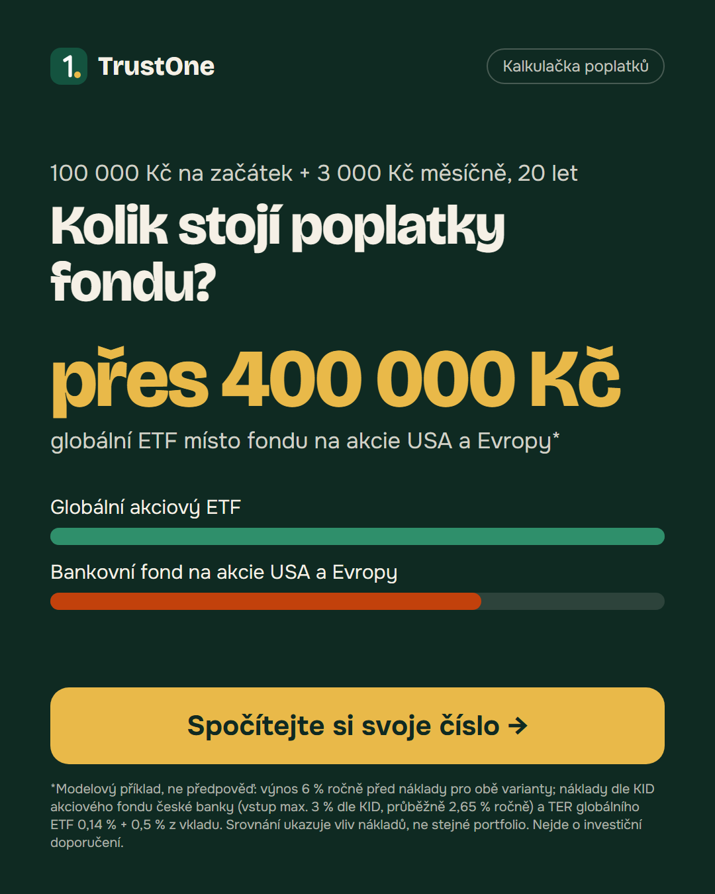
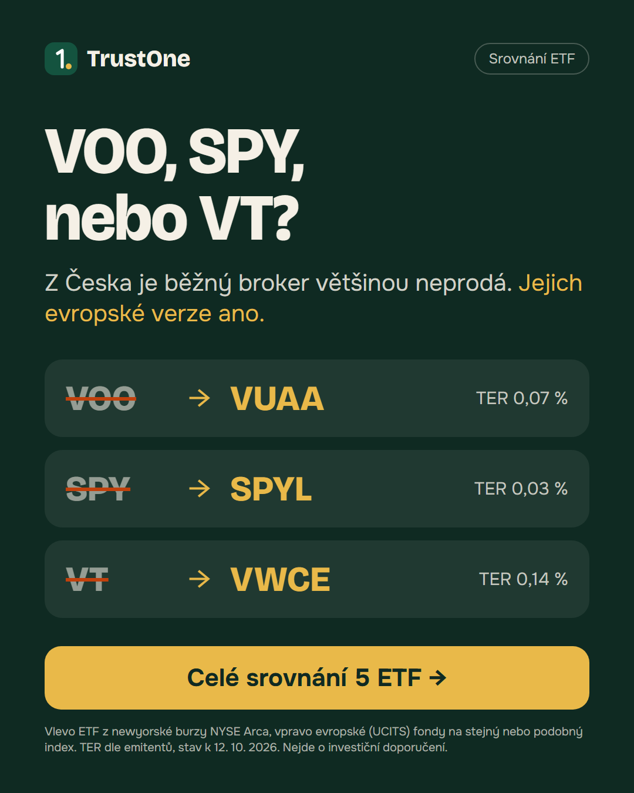

# Reklamy pro Meta (Facebook / Instagram feed, 1080 × 1350)

Obrázky se generují z HTML šablon: `npm run ads` (výstup `reklama-a-poplatky.png`, `reklama-b-srovnani.png`).
Čísla v reklamách hlídá test `src/lib/ads.test.ts` – když se změní data, test spadne dřív, než reklama začne lhát.

## Varianta A – poplatky (`utm_content=a_fees`)

| Pole v Meta | Text |
|---|---|
| Primární text | Kolik stojí poplatky fondu? Modelový příklad: 100 000 Kč na začátek a 3 000 Kč měsíčně po dobu 20 let. Globální akciový ETF místo bankovního fondu na akcie USA a Evropy: rozdíl vychází přes 400 000 Kč.* Spočítejte si to s vlastními čísly – zdarma a bez registrace.  *Výnos 6 % ročně před náklady pro obě varianty, náklady dle KID fondu (vstup max. 3 % dle KID) a TER ETF. Srovnání ukazuje vliv nákladů, ne stejné portfolio. Nejde o investiční doporučení. |
| Nadpis | Spočítejte si, kolik stojí poplatky |
| Popis | Kalkulačka s daty z KID a od emitentů |
| Tlačítko | Zjistit více |
| URL | `https://etf-landing-page-three.vercel.app/?utm_source=meta&utm_medium=paid_social&utm_campaign=etf_leadgen&utm_content=a_fees` |

**Navazující první obrazovka:** nadpis „Kolik vám za 20 let sní poplatky fondu?“ a stejný modelový příklad: velké číslo „přes 400 000 Kč“ jako v reklamě, pod ním přesná modelová hodnota (489 000 Kč) a předpoklady. Obojí se počítá z dat (`floorForClaim` a `roundForDisplay` v `src/lib/calc.ts`). „Přes 400 000 Kč“ platí i bez vstupního poplatku (453 000 Kč).

## Varianta B – srovnání (`utm_content=b_compare`)

| Pole v Meta | Text |
|---|---|
| Primární text | VOO, SPY a VT patří k nejznámějším ETF. Drobný investor z EU je ale u běžného brokera většinou nekoupí – chybí jim povinný dokument KID. Každé má evropskou verzi na stejný nebo podobný index. Podívejte se na srovnání 5 ETF s daty přímo od emitentů. Nejde o investiční doporučení. |
| Nadpis | VOO, SPY, nebo VT? Co z Česka opravdu koupíte |
| Popis | Srovnání 5 ETF a jejich evropských verzí |
| Tlačítko | Zjistit více |
| URL | `https://etf-landing-page-three.vercel.app/?utm_source=meta&utm_medium=paid_social&utm_campaign=etf_leadgen&utm_content=b_compare` |

**Navazující první obrazovka:** varianta `/b` (proxy přepne podle `utm_content` začínajícího na `b`) – stejné tři dvojice tickerů a TER jako v reklamě.

## Jak texty respektují pravidla Meta

- **Žádné osobní atributy:** texty neoslovují finanční situaci čtenáře („máte úspory…“, „banka vám bere…“), popisují produkt a modelový příklad.
- **Žádný slib výnosu:** částka je výslovně modelový rozdíl v nákladech se stejným předpokládaným výnosem pro obě varianty a s předpoklady přímo v reklamě.
- **Žádné osobní údaje v reklamě:** kontakt se sbírá až na stránce.
- **Žádná cizí loga ani jména bank:** tickery jsou jen text, bankovní fond je v reklamě anonymizovaný („akciový fond české banky“), konkrétní fond a jeho KID jsou uvedeny na stránce.
- **Disclaimer** „Nejde o investiční doporučení“ v obrázku i v textu.
- Před spuštěním ověřit v Ads Manageru, zda Meta pro ČR nevyžaduje ověření inzerenta finančních služeb.
